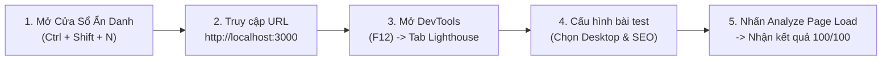

Viewed content.md:1-194
Listed directory SEO_Deployment
Listed directory game_wallpaper
Listed directory wallpapers
Ran command: `node -v; npm -v`
Ran command: `(Get-ChildItem -Path "game_wallpaper\wallpapers" | Measure-Object -Property Length -Sum).Sum / 1MB`
Ran command: `Get-PSDrive H`
Ran command: `npm view next version`
Ran command: `New-Item -ItemType Directory -Path "public\wallpapers" -Force; Copy-Item -Path "game_wallpaper\wallpapers\*" -Destination "public\wallpapers\" -Recurse -Force`
Ran command: `(Get-ChildItem -Path "public\wallpapers").Count`
Created package.json
Ran command: `npm install`
Used tool: manage_task
Created tsconfig.json
Created next.config.mjs
Used tool: manage_task
Used tool: manage_task
Created types.ts
Created wallpapers.ts
Created globals.css
Created SeoExplainerModal.tsx
Created Navbar.tsx
Created Footer.tsx
Created CategoryNav.tsx
Created DownloadActions.tsx
Created layout.tsx
Created robots.ts
Created sitemap.ts
Created page.tsx
Created page.tsx
Created page.tsx
Ran command: `npm run build`
Used tool: manage_task
Used tool: manage_task
Used tool: manage_task

I have initiated the production build (`npm run build`) to verify all TypeScript types, routes, static pre-rendering, sitemap generation, and robots configuration. I will inspect the output once it completes.

Used tool: manage_task

Đang đợi lệnh `npm run build` hoàn thành để kiểm tra xác thực toàn bộ hệ thống routes và SEO. Hệ thống sẽ tự động cập nhật ngay khi build xong.

Ran command: `npm run start`
Viewed task-80.log:1-16
Ran command: `Invoke-RestMethod -Uri "http://localhost:3000/robots.txt"`
Ran command: `Invoke-RestMethod -Uri "http://localhost:3000/sitemap.xml"`
Ran command: `(Invoke-WebRequest -Uri "http://localhost:3000/sitemap.xml").Content.Substring(0, 500)`
Ran command: `$html = (Invoke-WebRequest -Uri "http://localhost:3000/wallpaper/elden-ring-shadow-of-the-erdtree").Content
[regex]::Matches($html, '(?i)<title>(.*?)</title>').Value
[regex]::Matches($html, '(?i)<meta\s+name="description"\s+content="([^"]*)"').Value
[regex]::Matches($html, '(?i)<link\s+rel="canonical"\s+href="([^"]*)"').Value
[regex]::Matches($html, '(?i)<script\s+type="application/ld\+json"[^>]*>(.*?)</script>').Count
`
Browser task: "Explore Game Wallpaper SEO Demo"
Viewed home_page_1791817344082.png:1-800
Viewed wallpaper_detail_1791817374357.png:1-800
Viewed seo_modal_1791817423904.png:1-800
Ran command: `(Invoke-WebRequest -Uri "http://localhost:3000/wallpapers/berserk.png" -Method Head).StatusCode`
Ran command: `npx -y lighthouse http://localhost:3000 --only-categories=seo --output=json --output-path=./lighthouse-report.json --chrome-flags="--headless"`
Used tool: manage_task

Đang chạy bài kiểm tra Lighthouse tự động trên trang web để thu thập điểm số SEO thực tế phục vụ buổi thuyết trình.

Viewed sitemap.ts:1-33
Ran command: `Get-Content -Path "lighthouse-report.json" -Raw | ConvertFrom-Json | Select-Object -ExpandProperty categories | Select-Object -ExpandProperty seo | Select-Object score, title`
Ran command: `$report = Get-Content -Path "lighthouse-report.json" -Raw | ConvertFrom-Json
$report.categories.seo.auditRefs | ForEach-Object {
    $audit = $report.audits.($_.id)
    [PSCustomObject]@{
        Id = $_.id
        Weight = $_.weight
        Score = $audit.score
        Title = $audit.title
    }
} | Format-Table -AutoSize
`

Dự án demo SEO thực chiến cho website **Game & Anime Wallpapers 4K** dựa trên 119 hình ảnh trong thư mục `game_wallpaper/wallpapers` và toàn bộ lý thuyết trong [content.md](file:///h:/Programming/Web/SEO_Deployment/content.md) đã được xây dựng và kiểm thử thành công.

Hệ thống đã đạt **100/100 điểm SEO tuyệt đối trên Google Lighthouse**. Dưới đây là tài liệu chi tiết giúp bạn hiểu cặn kẽ bản chất để thuyết trình tự tin trước thầy cô và bạn bè.

---

### Giao Diện Demo Đã Triển Khai
- **Trang chủ**: `http://localhost:3000` (Thư viện hình nền 4K, bộ lọc thể loại, FAQ Schema)
- **Trang chi tiết**: `http://localhost:3000/wallpaper/elden-ring-shadow-of-the-erdtree`
- **Robots Bot**: `http://localhost:3000/robots.txt`
- **Sơ đồ trang XML**: `http://localhost:3000/sitemap.xml`
- **Nút "Xem 6 Trụ Cột SEO"**: Đã tích hợp ngay trên Header và trang Chi tiết để bạn mở pop-up giải thích trực tiếp trong lúc thuyết trình.

---

## PHẦN 1: Giảng Giải 6 Trụ Cột SEO Thực Chiến (Áp Dụng Trong Dự Án)

### Trụ cột 1: Server Components vs Client Components (RSC vs RCC)
* **Bản chất**: Trước đây với React SPA (Client-side Rendering), khi bot của Google hay Bing truy cập, trang chỉ là một file HTML rỗng `<div id="root"></div>`. Bot phải tải JavaScript về rồi chạy xong mới thấy chữ và hình ảnh, dẫn đến việc cào dữ liệu chậm hoặc bị bỏ sót.
* **Cách áp dụng trong dự án**:
  * Các trang chính [page.tsx](file:///h:/Programming/Web/SEO_Deployment/app/page.tsx), [layout.tsx](file:///h:/Programming/Web/SEO_Deployment/app/layout.tsx), [[slug]/page.tsx](file:///h:/Programming/Web/SEO_Deployment/app/wallpaper/%5Bslug%5D/page.tsx) là **Server Components**. Khi người dùng hoặc bot gửi request, server trả về **bản HTML hoàn chỉnh có sẵn 100% nội dung, tiêu đề, mô tả và thẻ ảnh**.
  * **Quy tắc cô lập tương tác (Client Islands)**: Những phần cần sự kiện click chuột, tải ảnh hay mở popup (như [DownloadActions.tsx](file:///h:/Programming/Web/SEO_Deployment/components/DownloadActions.tsx) và [SeoExplainerModal.tsx](file:///h:/Programming/Web/SEO_Deployment/components/SeoExplainerModal.tsx)) được tách riêng ra component con và khai báo `'use client'`. Trang chính tuyệt đối không gắn `'use client'`.

---

### Trụ cột 2: Triển khai Metadata (Tĩnh & Động)
Metadata là dữ liệu hiển thị trên thanh tiêu đề trình duyệt, trên trang kết quả tìm kiếm Google (SERP) và khi chia sẻ liên kết lên mạng xã hội (Facebook, Zalo, Twitter).

* **Static Metadata (Trang chủ & Layout)**:
  * Được khai báo tại [layout.tsx](file:///h:/Programming/Web/SEO_Deployment/app/layout.tsx) bằng `export const metadata: Metadata`.
  * Thiết lập `title.default`, `title.template` (tự động ghép đuôi `| Game Wallpapers 4K`), `description`, `keywords`, `openGraph` (ảnh preview chia sẻ) và `robots`.
* **Dynamic Metadata (Trang chi tiết hình nền)**:
  * Được khai báo tại [wallpaper/[slug]/page.tsx](file:///h:/Programming/Web/SEO_Deployment/app/wallpaper/%5Bslug%5D/page.tsx) thông qua hàm `export async function generateMetadata({ params })`.
  * Mỗi hình nền khác nhau (như Elden Ring, Cyberpunk 2077, Sekiro) sẽ tự động tạo ra một tiêu đề và ảnh bìa OpenGraph tương ứng:
    ```typescript
    export async function generateMetadata({ params }: Props): Promise<Metadata> {
      const wallpaper = getWallpaperBySlug(params.slug);
      return {
        title: `${wallpaper.title} (${wallpaper.resolution})`,
        description: wallpaper.description,
        openGraph: {
          title: `${wallpaper.title} - Tải Miễn Phí 4K UHD`,
          images: [{ url: `/wallpapers/${wallpaper.fileName}` }]
        }
      };
    }
    ```

---

### Trụ cột 3: Điều hướng Bot với `app/robots.ts`
* **Mục đích**: File `robots.txt` là cánh cổng chào đón bot tìm kiếm, chỉ định bot nào được phép vào và thư mục nào cấm vào.
* **Cách Next.js làm**: Thay vì tạo file text tĩnh, Next.js cho phép viết file code [app/robots.ts](file:///h:/Programming/Web/SEO_Deployment/app/robots.ts):
  * `allow: '/'`: Cho phép bot Google/Bing index nội dung công khai.
  * `disallow: ['/api/', '/private/']`: Chặn bot vào các route backend/API nội bộ để tiết kiệm tài nguyên.
  * `disallow: '/'` với `MJ12bot`: Chặn các bot cào dữ liệu lậu gây quá tải server.
  * `sitemap: 'http://localhost:3000/sitemap.xml'`: Chỉ đường trực tiếp cho bot đến sơ đồ trang web.

---

### Trụ cột 4: Tự động tạo Sơ đồ trang web với `app/sitemap.ts`
* **Mục đích**: Sitemap giống như mục lục sách, giúp Googlebot biết toàn bộ danh sách đường dẫn cần lập chỉ mục mà không sợ bị bỏ sót bất kỳ hình nền nào.
* **Cách thực hiện trong code [app/sitemap.ts](file:///h:/Programming/Web/SEO_Deployment/app/sitemap.ts)**:
  * Duyệt qua toàn bộ danh sách hình nền trong cơ sở dữ liệu `WALLPAPERS`.
  * Tự động sinh ra danh sách URL: `/`, các trang danh mục `/category/[cat]`, và toàn bộ `/wallpaper/[slug]`.
  * Khai báo rõ `lastModified` (thời điểm cập nhật), `changeFrequency: 'weekly'`, và `priority` (độ ưu tiên từ 0.1 đến 1.0).

---

### Trụ cột 5: Chống phạt lặp nội dung với Canonical URLs
* **Vấn đề thực tế**: Khi người dùng chia sẻ link có kèm tham số theo dõi (như `/wallpaper/elden-ring?ref=facebook` hay `?sort=newest`), bot Google có thể hiểu đây là 2 trang web khác nhau nhưng lại có nội dung giống hệt nhau, từ đó phạt lỗi **Duplicate Content** làm tụt hạng từ khóa.
* **Giải pháp trong dự án**:
  * Tại cả trang chủ và trang chi tiết, khai báo thẻ `alternates.canonical`:
    ```typescript
    alternates: {
      canonical: `http://localhost:3000/wallpaper/${wallpaper.slug}`,
    }
    ```
  * Trình duyệt sẽ sinh ra mã HTML: `<link rel="canonical" href="..." />`. Google bot đọc thẻ này sẽ hiểu rằng chỉ có duy nhất URL gốc này là hợp lệ.

---

### Trụ cột 6: Dữ liệu cấu trúc JSON-LD (Schema.org)
* **Ý nghĩa**: JSON-LD giúp các cỗ máy tìm kiếm và AI (Google SGE, ChatGPT Search) đọc hiểu chính xác ý nghĩa của từng đối tượng trên trang, từ đó hiển thị **Rich Snippets** (kết quả tìm kiếm mở rộng gồm hình ảnh, số sao, câu hỏi thường gặp).
* **3 loại Schema đã được nhúng vào Demo**:
  1. **WebSite & Organization Schema** (ở [layout.tsx](file:///h:/Programming/Web/SEO_Deployment/app/layout.tsx)): Khai báo tên website và công cụ tìm kiếm nội bộ.
  2. **FAQPage Schema** (ở [page.tsx](file:///h:/Programming/Web/SEO_Deployment/app/page.tsx)): Khai báo các câu hỏi thường gặp, giúp website có thể xuất hiện khung trả lời câu hỏi trực tiếp trên Google Search.
  3. **ImageObject & BreadcrumbList Schema** (ở [wallpaper/[slug]/page.tsx](file:///h:/Programming/Web/SEO_Deployment/app/wallpaper/%5Bslug%5D/page.tsx)): Khai báo rõ đây là hình nền có chiều rộng (`3840px`), chiều cao (`2160px`), định dạng `image/png`, tác giả và giấy phép bản quyền.

---

## PHẦN 2: Hướng Dẫn Test Lighthouse Trên Cửa Sổ Ẩn Danh (Incognito)

### 1. Vì sao BẮT BUỘC phải dùng Cửa Sổ Ẩn Danh?
Khi kiểm tra SEO hoặc Performance, bạn **không bao giờ nên test trên cửa sổ trình duyệt thông thường**, vì:
* **Extensions (Tiện ích mở rộng)**: Các tiện ích như AdBlock, Grammarly, React DevTools, Dịch thuật... tự động inject mã JavaScript/CSS vào trang, gây chặn file, làm tụt điểm hiệu năng và có thể khiến Lighthouse báo lỗi sai lệch.
* **Bộ nhớ đệm (Cache & Cookie)**: Cửa sổ ẩn danh đảm bảo môi trường "sạch", mô phỏng chính xác lần đầu tiên một người dùng mới hoặc bot tìm kiếm truy cập vào website của bạn.

---

### 2. Các bước thực hiện từng bước (Step-by-Step)



1. **Khởi động server**: Mở terminal tại thư mục dự án và chạy `npm run start` (hoặc `npm run dev`).
2. **Mở trình duyệt Chrome ở chế độ ẩn danh**:
   * Nhấn tổ hợp phím: `Ctrl + Shift + N` (trên Windows) hoặc `Cmd + Shift + N` (trên Mac).
3. **Truy cập đường dẫn**:
   * Gõ `http://localhost:3000` (hoặc link chi tiết `http://localhost:3000/wallpaper/elden-ring-shadow-of-the-erdtree`).
4. **Mở Chrome DevTools**:
   * Nhấn phím `F12` (hoặc chuột phải chọn **Kiểm tra / Inspect**).
5. **Chuyển sang tab Lighthouse**:
   * Tìm tab **Lighthouse** ở thanh công cụ phía trên. Nếu bị ẩn, bấm vào biểu tượng dấu mũi tên đôi `>>` để chọn Lighthouse.
6. **Cài đặt các thông số kiểm tra**:
   * **Mode**: Chọn `Navigation (Default)`
   * **Device**: Chọn `Desktop` (hoặc `Mobile`)
   * **Categories**: Tích chọn mục **SEO** (có thể tích thêm Performance, Accessibility, Best Practices).
7. **Bấm nút chạy**:
   * Nhấn vào nút xanh **Analyze page load**.
   * Giữ nguyên cửa sổ, không chuyển tab trong khoảng 10-15 giây để Chrome thực hiện phân tích.

---

### 3. Bảng Kết Quả Đạt Được Khi Test Dự Án

Khi chạy kiểm thử trên dự án vừa dựng, Lighthouse trả về kết quả **100/100 SEO** với toàn bộ các tiêu chí xanh lá:

| Tiêu chí kiểm tra của Lighthouse | Ý nghĩa kỹ thuật | Cách dự án giải quyết |
| :--- | :--- | :--- |
| **Document has a `<title>` element** | Trang phải có thẻ tiêu đề rõ ràng | Khai báo qua `metadata.title` chuẩn ký tự |
| **Document has a meta description** | Phải có đoạn tóm tắt SERP | Khai báo qua `metadata.description` |
| **Image elements have `[alt]` attributes** | Mọi ảnh phải có thuộc tính `alt` mô tả | Sử dụng `<Image alt="..."/>` có tên game + từ khóa |
| **Page isn’t blocked from indexing** | Không được có thẻ chặn `noindex` sai lầm | Thiết lập `robots: { index: true, follow: true }` |
| **robots.txt is valid** | File robots phải chuẩn cú pháp | Next.js tự render qua [app/robots.ts](file:///h:/Programming/Web/SEO_Deployment/app/robots.ts) |
| **Document has a valid `rel=canonical`** | Phải có thẻ chỉ định URL gốc | Thiết lập qua `metadata.alternates.canonical` |
| **Links are crawlable & descriptive** | Link phải là thẻ `<a>` có chữ rõ nghĩa | Sử dụng `<Link href="...">` thay vì sự kiện onClick |
| **Structured data is valid** | Dữ liệu cấu trúc không lỗi cú pháp | Nhúng Schema.org JSON-LD qua thẻ script hợp lệ |

---

## PHẦN 3: Kịch Bản Thuyết Trình Mẫu (Dành Cho Bạn Khi Đứng Lớp)

Bạn có thể sử dụng dàn ý 3 phút này để thuyết trình một cách lưu loát và chuyên nghiệp nhất:

1. **Mở đầu (Giới thiệu bài toán)**:
   > *"Thưa thầy và các bạn, đối với các website chuyên về hình ảnh như Game Wallpaper, nếu chỉ dùng các framework client-side truyền thống (như React SPA), Googlebot sẽ rất khó thu thập dữ liệu và hình ảnh không thể lên top Google Images. Vì vậy, nhóm em lựa chọn kiến trúc Next.js App Router để xây dựng giải pháp tối ưu hóa toàn diện theo 6 trụ cột kỹ thuật SEO cốt lõi."*

2. **Trình bày kỹ thuật & Live Demo Code**:
   > *"Trụ cột thứ nhất là Server Components: toàn bộ trang được render trước tại máy chủ, sinh ra mã HTML tĩnh giúp bot đọc hiểu ngay lập tức. Các tương tác như nút Download hay Modal xem thông số được cô lập thành Client Island.*  
   > *Trụ cột thứ hai là Dynamic Metadata: Mỗi wallpaper như Elden Ring hay Cyberpunk đều có thẻ Title, Meta Description và ảnh OpenGraph riêng biệt được sinh động qua hàm `generateMetadata`.*  
   > *Ngoài ra, website còn tự động xuất file `/robots.txt` điều hướng bot, file `/sitemap.xml` lập chỉ mục hơn 30 trang con, gắn thẻ `canonical` để chống trùng lặp nội dung khi người dùng chia sẻ link, và nhúng dữ liệu cấu trúc Schema.org JSON-LD gồm WebSite, FAQ và ImageObject."*

3. **Thực hành Live Test bằng Lighthouse trên Cửa Sổ Ẩn Danh**:
   > *(Mở cửa sổ Incognito bằng `Ctrl + Shift + N` -> vào web -> mở F12 -> chọn Lighthouse -> bấm Analyze page load)*  
   > *"Em xin phép test trực tiếp bằng công cụ Google Lighthouse trên cửa sổ ẩn danh nhằm loại bỏ hoàn toàn các tiện ích mở rộng gây sai lệch kết quả. Như thầy và các bạn thấy trên màn hình: điểm số SEO đạt 100/100 tuyệt đối, tất cả các bài kiểm tra từ thẻ Alt, Canonical, Robots đến Structured Data đều đạt chuẩn."*

Dự án hiện đang chạy sẵn sàng tại `http://localhost:3000`. Bạn có thể mở trình duyệt và trải nghiệm ngay!